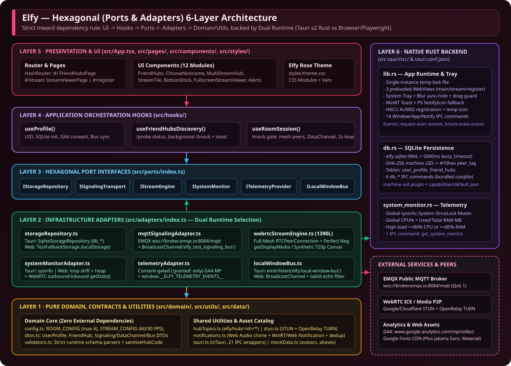
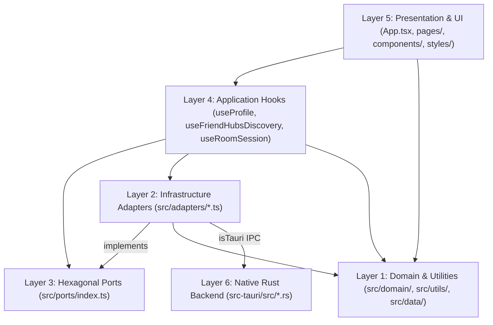

# 01 — Architecture & Layers

Elfy follows a **Hexagonal Architecture (Ports & Adapters)** combined with a **Dual-Runtime Abstraction** so identical UI and session orchestration code runs seamlessly inside the Tauri v2 desktop shell and in standard Chromium browsers during development or Playwright E2E testing.

---

## Layer Dependency Rule

Dependencies strictly point **inward toward `src/domain/` and `src/ports/`**, and **downward from UI to Hooks**:

> [!NOTE]
> Components never import Tauri APIs, MQTT clients, SQLite SQL, or raw `RTCPeerConnection` internals directly. UI pages (`src/pages/`) handle top-level navigation (`tauri.ts` window calls vs. React Router `navigate()`), while hooks orchestrate state against ports/adapters and utilities.

---

## The Six Architectural Layers

### Layer 1 — Pure Domain, Contracts & Utilities
Located in `src/domain/`, `src/types/`, `src/utils/`, and `src/data/`. Contains zero framework UI or I/O side effects at the domain level.

| File | Responsibility | Key Symbols & Constants |
| --- | --- | --- |
| `src/domain/config.ts` | Global constants across signaling, room capacity, streaming, and telemetry | `ROOM_CONFIG` (`ENFORCE_MAX_PEERS: true`, `MAX_CONCURRENT_PEERS: 6`), `STREAM_CONFIG` (`DEFAULT_FPS: 60`, `FALLBACK_FPS: 30`, `STREAM_FPS_OPTIONS: [30, 60, 120]`, `DEFAULT_RESOLUTION: '1080p'`, `STREAM_RESOLUTION_OPTIONS: ['720p', '1080p', 'source']`, `CONTENT_HINT: ''`, `RESOLUTION_DIMENSIONS`, `MAX_BITRATE_BPS`, `MESH_BITRATE_SCALE_BY_VIEWERS`, `MIN_VIDEO_BITRATE_BPS`, `SDP_BITRATE_START_FACTOR`, `SDP_BITRATE_MAX_CEILING_KBPS`), `TELEMETRY_CONFIG`, `SIGNALING_CONFIG` |
| `src/domain/dtos.ts` | Core entities and versioned (`version: 1`) wire schemas | `UserProfile`, `ProfileRowDto`, `FriendHubRecordDto`, `FriendHubViewModel`, `TelemetryEventName` (7 events), `SignalingEnvelopeDto` (8 types), `DataChannelEnvelopeDto` (10 types), `LocalWindowBusMessage` (5 types) |
| `src/domain/validators.ts` | Defensive runtime JSON validation & capacity checks | `parseSignalingEnvelope`, `parseDataChannelMessage`, `parseLocalBusMessage`, `sanitizeHubCode`, `canAcceptMorePeers`, `isRecord`, `isTelemetryConsentState` |
| `src/types/index.ts` | Public type barrel | Re-exports everything from `../domain/dtos` |
| `src/utils/hubTopics.ts` | Canonical Hub ID & MQTT topic builders | `toSafePeerTag`, `formatFullPeerTag`, `normalizeHubTopic`, `getKnockTopic`, `getProbeTopic`, `getGuestInboxTopic`, `extractHostFromHub`, `isHubOwner` |
| `src/utils/stun.ts` | WebRTC ICE server registry & pool policy | `ICE_SERVERS` (5 Google STUN + 1 Cloudflare STUN + 4 OpenRelay Metered TURN/TURNS), `getRtcConfiguration()` (`iceCandidatePoolSize: 4`, `bundlePolicy: 'max-bundle'`) |
| `src/utils/notifications.ts` | Chime synthesis, notification routing & spam guard | `playKnockSound()` (587.33 Hz + 880 Hz Web Audio chime), `showKnockNotification()` (1200ms memory + `localStorage` dedup) |
| `src/utils/tauri.ts` | Safe runtime bridge & typed IPC wrappers | `isTauri()` (`window.__TAURI_INTERNALS__`), `safeInvoke`, `invokeOrThrow`, `resolveMachineUid`, window drag threshold (`beginWindowDragOnMove` 4px), 21 IPC command wrappers |
| `src/data/mockData.ts` | Static mascot, avatar & placeholder alias catalog | `ELFY_MASCOT_ICON`, `ELFY_HAPPY`, `AVATAR_OPTIONS` (5 entries), `DEFAULT_USER_PROFILE`, `CUTE_ALIASES` (16 entries) |

### Layer 2 — Infrastructure Adapters (`src/adapters/`)
Concrete implementations exported via `src/adapters/index.ts` as singletons (`storageRepository`, `signalingTransport`, `streamEngine`, `systemMonitor`, `telemetryProvider`, `localWindowBus`) alongside their classes for isolated instantiation/testing.

| Module | Class(es) / Adapter | Port Implemented |
| --- | --- | --- |
| `storageRepository.ts` | `SqliteStorageRepository` (Tauri) / `TestFallbackStorageRepository` (Browser `localStorage`) | `IStorageRepository` |
| `mqttSignalingAdapter.ts` | `MqttSignalingAdapter` (EMQX WebSocket MQTT + `BroadcastChannel('elfy_test_signaling_bus')`) | `ISignalingTransport` |
| `webrtcStreamEngine.ts` + `webrtc/*` | `WebRtcStreamEngine` facade (`213 lines`) delegating to `src/adapters/webrtc/` (`captureManager.ts`, `codecSelector.ts`, `peerNegotiator.ts`, `sdpBitrate.ts`, `dataChannelRouter.ts`, `statsCollector.ts`, `peerTypes.ts`) | `IStreamEngine` |
| `systemMonitorAdapter.ts` | `SystemMonitorAdapter` (Rust `sysinfo` vs. JS loop-drift/heap + `WebRtcStreamEngine.getStatsSnapshot`) | `ISystemMonitor` |
| `telemetryAdapter.ts` | `TelemetryAdapter` (Consent-gated GA4 Measurement Protocol + `window.__ELFY_TELEMETRY_EVENTS__`) | `ITelemetryProvider` |
| `localWindowBus.ts` | `LocalWindowBus` (`@tauri-apps/api/event` vs. `BroadcastChannel` scoped by UID + `tabId` filter) | `ILocalWindowBus` |

### Layer 3 — Hexagonal Ports (`src/ports/index.ts`)
Defines the 6 runtime-agnostic TypeScript interfaces:
1. `IStorageRepository` — Profile CRUD, telemetry consent state, Friend Hub CRUD (`getOrInitProfile`, `updateProfile`, `setTelemetryConsent`, `listFriendHubs`, `upsertFriendHub`, `removeFriendHub`).
2. `ISignalingTransport` — Connect/disconnect, publish JSON envelopes, subscribe with unsubscribe handle.
3. `IStreamEngine` — Local stream capture (`startScreenCapture(fps?, resolution?)`, `stopScreenCapture`), `30`/`60`/`120` FPS & resolution preset control (`setStreamFps`, `setStreamResolution`, `getCurrentResolution`, `refreshSenderEncodingParams`, `setCpuThrottleFactor`), remote/mesh peer connections (`initiatePeerConnection`, `handleIncomingOffer`, `handleIncomingAnswer`, `handleIncomingIce`, `closePeer`, `closeAll`), DataChannel broadcast/send, keepalive cleanup (`pingAndCleanupPeers`), and WebRTC stats (`StreamEngineCallbacks`, `WebRtcStatsSnapshot`).
4. `ISystemMonitor` — Runtime CPU/RAM/network performance metrics snapshot and warning flag.
5. `ITelemetryProvider` — Opt-in telemetry consent updates and anonymous event dispatch.
6. `ILocalWindowBus` — Multi-window / multi-tab message pub-sub (`publish`, `subscribe`).

### Layer 4 — Application Orchestration Hooks (`src/hooks/`)
Stateful React hooks that drive the entire application lifecycle:
- **`useProfile()` (`src/hooks/useProfile.ts`)**: Deduped initial profile hydration via module-level `profileInitCache`, syncs `TelemetryAdapter` consent and fires `app_opened` once per session, exposes `saveProfile()`, `setTelemetryConsent()`, `isRegistered` (`!isLoading && Boolean(profile.machineHash)`), and subscribes to `profile_updated` on `localWindowBus`.
- **`useFriendHubsDiscovery()` (`src/hooks/useFriendHubsDiscovery.ts`)**: Manages saved Friend Hubs, subscribes to guest inboxes on each hub, probes live status (`hub_status_request`/`hub_status_response` with `PROBE_TIMEOUT_MS = 1500`), handles `minimizedHub` banner state via `localWindowBus`, **and keeps a background `/knock` + Windows toast action listener alive in the Companion window** even when the Watch Room window is hidden.
- **`useRoomSession()` (`src/hooks/useRoomSession.ts`)**: `597`-line top-level session orchestrator composing focused hooks (`useMediaSharing`, `useMeshPeers`, `useKnockGate`, `useRoomMetrics`, and `src/hooks/room/roomHelpers.ts`) to manage Host (`owner`) and Guest (`guest`) state machines, knock admission with 30s timeout and `canAcceptMorePeers` gating, pre-accept WebRTC signal buffering, deterministic guest-guest mesh initiation, `elfy-control` DataChannel state sync, live profile propagation, decoupled 2-second keepalive (`KEEPALIVE_POLL_MS`) & metrics (`METRICS_POLL_MS`) polling, opt-in local self-preview, and connection failure diagnostics.

### Layer 5 — Presentation & UI (`src/App.tsx`, `src/pages/`, `src/components/`, `src/styles/`)
- `src/main.tsx` mounts `<App />`.
- `src/App.tsx` wraps `<HashRouter>` with routes `/`, `/stream`, `/register`, auto-opens the Tauri `register` window if `!profile.isRegistered`, and mounts the global `<TelemetryConsentModal />` when `telemetryConsent === 'unset'`.
- `src/pages/` (`FriendHubsPage`, `StreamViewerPage`, `RegisterPage`) bridge UI actions with either Tauri window IPC or SPA `navigate()`.
- `src/components/` provides 12 modular UI components styled via colocated CSS Modules and `src/styles/theme.css`.

### Layer 6 — Native Rust Backend (`src-tauri/src/`)
- `main.rs` -> `lib.rs` (single-instance lock, system tray, 2 preloaded windows `main`/`stream` + lazy `register`, blur/close policies, 13 window/app IPC commands).
- `toast.rs` (`ToastState` managed atomic toast routing & dedup, WinRT/PowerShell notifications, 5 toast IPC commands).
- `db.rs` (pooled `DbState(Mutex<Connection>)` initialized once at startup, `elfy.sqlite`, WAL mode, SHA-256 `peer_tag`, 6 `db_*` commands).
- `system_monitor.rs` (`sysinfo` CPU/RAM sampler, `get_system_metrics` command).

---

## Dual-Runtime Architecture (Tauri vs. Browser / Playwright)

Elfy detects its execution environment via `isTauri()` (`Boolean((window as { __TAURI_INTERNALS__?: unknown }).__TAURI_INTERNALS__)` in `src/utils/tauri.ts`) and `navigator.webdriver`:

| Subsystem | Tauri Desktop Runtime | Browser / Playwright E2E Runtime |
| --- | --- | --- |
| **Window Management** | 2 preloaded OS WebViews (`main`, `stream`) toggled via `hide()`/`show()` + lazy on-demand `register` window created on `show_register_window` and closed on completion | Single browser tab (`HashRouter` `navigate()`) or multiple Playwright tabs; Persona modal opens inline in `FriendHubsPage` |
| **Machine Identity (`UID`)** | Hardware UID via `@skipperndt/plugin-machine-uid` | Isolated per tab via `sessionStorage.getItem('elfy_test_machine_uid')` (generated with `ShortUniqueId` if unset) |
| **Persistence** | `SqliteStorageRepository` -> Rust `db_*` IPC -> `elfy.sqlite` (WAL) | `TestFallbackStorageRepository` -> `localStorage` bucket keyed by `elfy_test_db_<sha256>` |
| **Cross-Window Sync** | Tauri event `'elfy:local-window-bus'` broadcast to all WebViews | `BroadcastChannel('elfy_local_window_bus')` filtered by `scopeId` (UID) and `tabId` (anti-self-echo) |
| **Signaling Relay** | EMQX public broker (`wss://broker.emqx.io:8084/mqtt`, QoS 1) | EMQX + `BroadcastChannel('elfy_test_signaling_bus')` instant loopback; non-blocking MQTT connect when `navigator.webdriver` is true |
| **Screen & Audio Capture** | `navigator.mediaDevices.getDisplayMedia()` (with fallback if unavailable) | Synthetic 1280x720 animated `<canvas>` + 440Hz muted `AudioContext` stream when `__ELFY_FORCE_SYNTHETIC_STREAM__`, `__ELFY_TEST_STREAM__`, or `navigator.webdriver` is active (fallback if `getDisplayMedia` unavailable) |
| **Knock Notifications** | `show_knock_toast` (WinRT interactive Toast with Allow/Decline -> PowerShell balloon -> Web Notification) + Web Audio chime | Browser `Notification` API (with `window.__ELFY_LAST_KNOCK_NOTIFICATION__` test hook) + Web Audio chime |
| **Hardware & Metrics** | Native Rust `sysinfo` crate via `get_system_metrics` | JS `setTimeout` event-loop drift CPU estimator + `performance.memory` JS heap + WebRTC `getStats()` |
