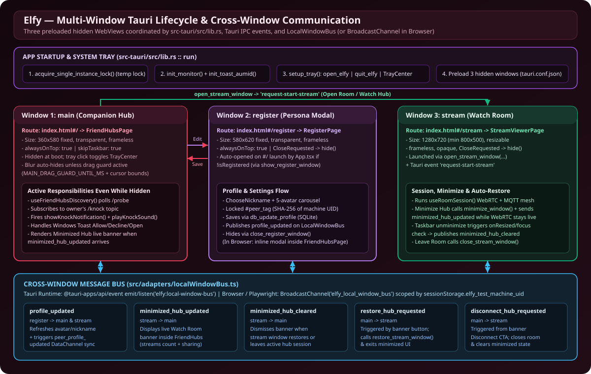
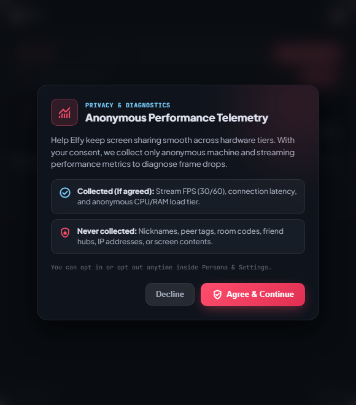
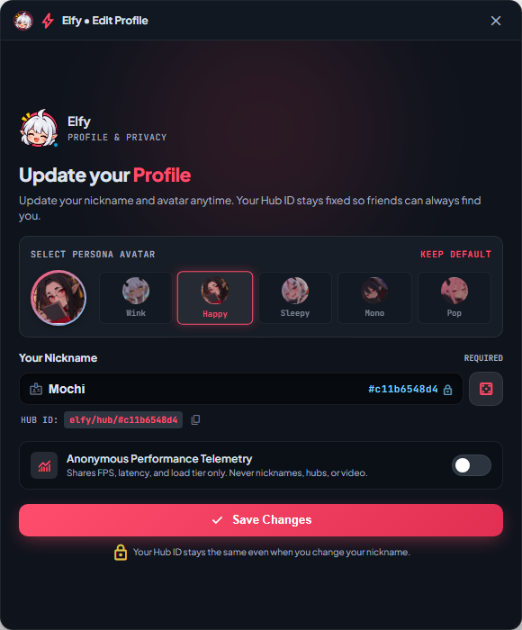
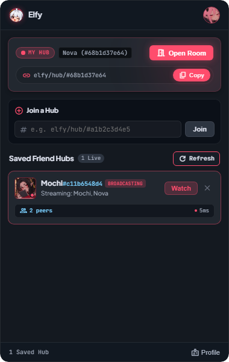
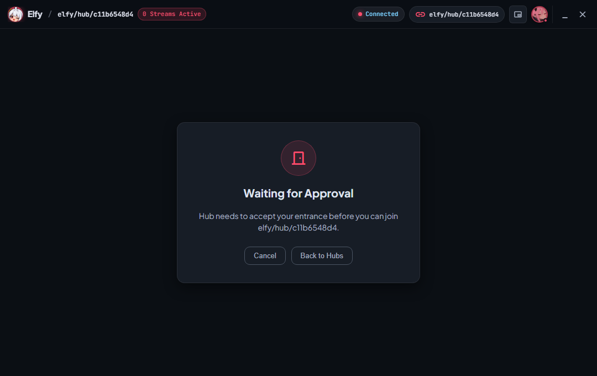
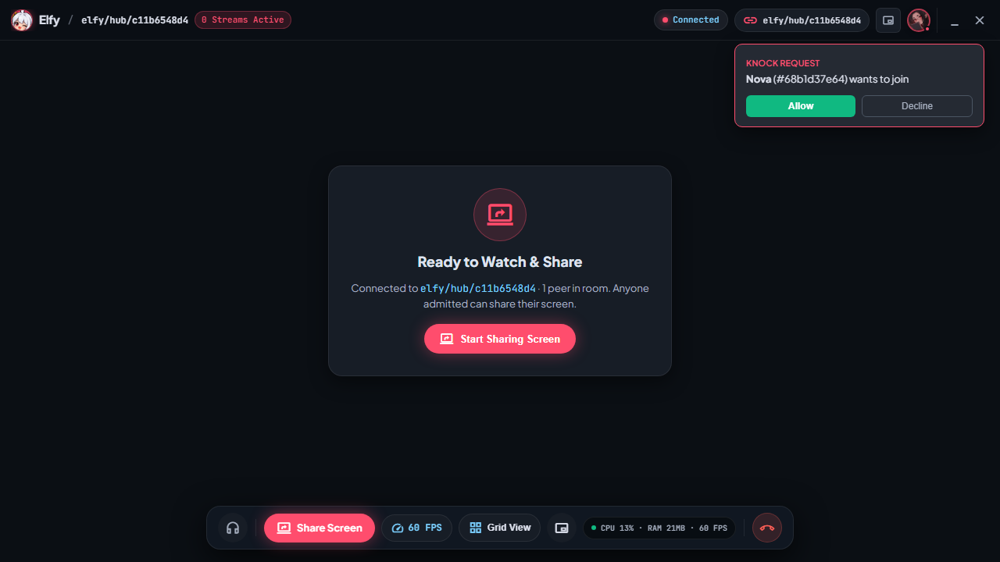
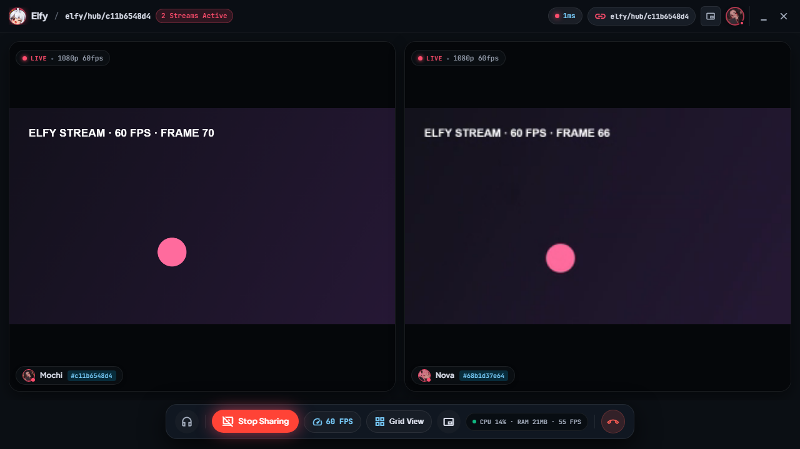
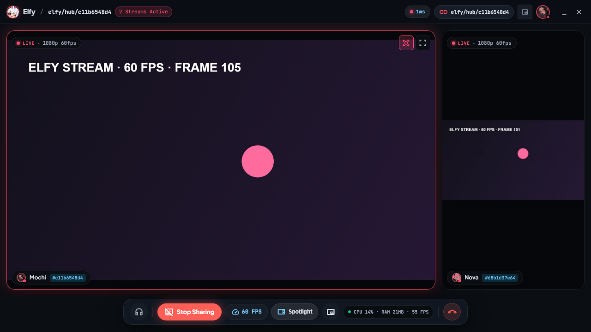
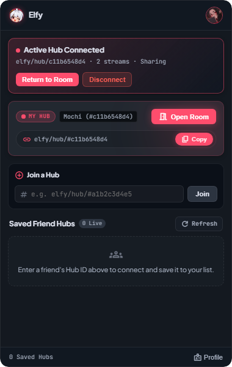
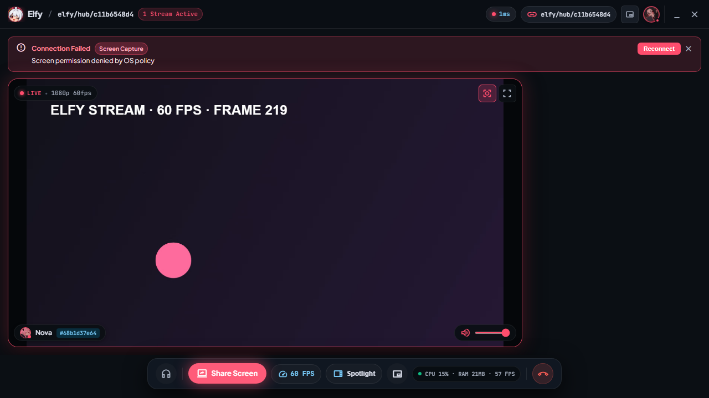

# 02 — Multi-Window Architecture & UI Flows

In desktop mode, Elfy runs **two eagerly preloaded, hidden Tauri WebViews (`main`, `stream`)** plus a **lazily created `register` WebView** sharing one frontend bundle via React Router `HashRouter`. Preloading `main` and `stream` keeps tray and Watch Room openings instantaneous, while instantiating `register` only on demand avoids idle WebView2 RAM overhead after initial setup.

---

## Preloaded Tauri Windows (`src-tauri/tauri.conf.json`)

| Label | Hash Route | Dimensions | Window Properties | Close / Blur Behavior |
| --- | --- | --- | --- | --- |
| `main` | `index.html#/` | `360 x 580` (non-resizable) | Frameless, transparent background, `alwaysOnTop: true`, `skipTaskbar: true`, starts hidden | Auto-hides on `Focused(false)` **except** during a drag guard (`MAIN_DRAG_GUARD_UNTIL_MS`) or when the OS cursor remains inside window bounds |
| `stream` | `index.html#/stream` | `1280 x 720` (min `800 x 500`, resizable) | Frameless, opaque (`#1a0a10`), starts hidden | Intercepts `CloseRequested` with `api.prevent_close()` and calls `window.hide()` so sessions stay recoverable |
| `register` | `index.html#/register` | `580 x 620` (non-resizable) | Frameless, transparent, `alwaysOnTop: true`, created lazily & centered on demand | Instantiated only when `show_register_window` is called (auto-triggered on launch by `App.tsx` if `!profile.isRegistered`) and destroyed via `window.close()` when finished |

### Cross-Window Navigation & Minimize/Restore Flows
1. **Companion -> Watch Room**: `FriendHubsPage` invokes `openStreamWindowTauri(hubId, autoStart, joinedAs)` (`open_stream_window` command in `lib.rs` + `'request-start-stream'` event). `StreamViewerPage` listens for `'request-start-stream'`, navigates React Router to the new hash route, and starts `useRoomSession`.
2. **Minimize Hub to Companion**: Clicking `minimize-hub-btn` publishes `minimized_hub_updated` via `LocalWindowBus` (`stream -> main`) and calls `minimizeWindowTauri()` (`minimize_window` in `lib.rs`). `FriendHubs` renders `minimized-hub-banner` with live stream count and `Return to Room` / `Disconnect` actions.
3. **Restore (via Banner or Taskbar)**: Clicking `Return to Room` publishes `restore_hub_requested` on `LocalWindowBus` -> `StreamViewerPage` calls `restore_stream_window()` and emits `minimized_hub_cleared`. If the user restores `stream` directly from the Windows taskbar, `StreamViewerPage` checks `isWindowMinimizedTauri()` on `onResized`, `focus`, and `visibilitychange` (with a `150ms` fallback check) and clears the minimized state.
4. **Leave Room**: Clicking `leave-room-btn` invokes `closeStreamWindowTauri()` (`close_stream_window` in `lib.rs`), hiding `stream` and restoring/centering `main` near the tray.

---

## Screen & Flow Walkthrough (Live Screenshots)

### 1. First-Launch Privacy Gate (`TelemetryConsentModal`)
Rendered globally inside `App.tsx` whenever `profile.telemetryConsent === 'unset'`. Blocks background UI with a backdrop until the user clicks `Agree & Continue` (`'granted'`) or `Decline` (`'denied'`), persisted immediately via `db_set_telemetry_consent`.

### 2. Persona Setup & Edit Window (`/#/register` -> `RegisterPage` + `ChooseNickname`)
Displays the mascot header, 5 avatar choices (`Wink`, `Happy`, `Sleepy`, `Mono`, `Pop` from `AVATAR_OPTIONS`), a nickname input with cute-alias randomizer (`CUTE_ALIASES`), the immutable hardware-derived `#peer_tag` (`#` + 10 hex chars), copyable Hub ID (`elfy/hub/#<tag>`), and an opt-in/opt-out **Anonymous Performance Telemetry** toggle.

### 3. Companion Window (`/#/` -> `FriendHubsPage` + `FriendHubs`)
The `360 x 580` system-tray companion lists:
- **My Hub Card**: Owner's nickname, `#peer_tag`, canonical share link, `Open Room` button, and `Copy` button.
- **Join a Hub Form**: Paste any `elfy/hub/#...` or raw 10-char tag (`sanitizeHubCode`) and click `Join`.
- **Saved Friend Hubs**: Live presence cards probed via `/probe`, showing avatar, `#tag`, `BROADCASTING` / live state, active streamers, peer count badge, measured RTT latency (`ms`), `Watch` button, and remove (`×`) button.

### 4. Knock-to-Enter Gate & Host Admission (`GuestKnockGate` + `HostKnockAlert`)
When a guest joins a host's room (`joinedAs=guest`), `useRoomSession` enters `knocking` state with a 30-second countdown (`GuestKnockGate`).

On the host side, if the Watch Room is open it renders the top-right `HostKnockAlert` (`Allow` / `Decline`), while playing the Web Audio chime (`playKnockSound`). If the Watch Room is closed/backgrounded, `useFriendHubsDiscovery` catches the knock in `main` and triggers a native Windows WinRT interactive toast (`Allow` / `Decline`).

### 5. Watch Room Grid, Spotlight & Fullscreen (`/#/stream` -> `StreamViewerPage`)
`MultiStreamHub` arranges up to **6 concurrent peer video streams**:
- **Grid View** (`06-multi-stream-grid.png`): Balanced multi-column CSS grid where each `StreamTile` shows `LIVE · 1080p 60fps`, Peer nickname + `#tag` pill, hover/per-tile volume slider, spotlight pin button, and fullscreen button.

- **Spotlight View** (`07-multi-stream-spotlight.png`): Clicking `layout-toggle-btn` or a tile's spotlight button promotes one active stream to a large primary viewport with remaining peers arranged in a vertical side strip.

- **Fullscreen Viewer (`FullscreenStreamViewer`)**: Clicking a tile's fullscreen button opens an overlay viewer with a 2.5-second auto-hiding HUD control bar and `Escape` key exit.

### 6. Minimized Hub Banner & Diagnostics (`ConnectionFailureBanner`)
Minimizing the Watch Room switches to the Companion with a live status banner (`Active Hub Connected · N streams`), allowing one-click return or disconnect without tearing down WebRTC peer connections.

Screen capture permission errors, Signaling broker drops, WebRTC ICE failures, and Knock rejections surface inside `ConnectionFailureBanner` with categorized severity badges (`Screen Capture`, `Signaling`, `WebRTC`, `Knock Gate`) and a `Reconnect` button.

---

## Component Inventory (`src/components/`)

Components follow folder-per-component organization (`src/components/<Component>/<Component>.tsx` and `src/components/MultiStreamHub/<Component>.tsx`):

| Component | Path | Purpose | Parent / Consumers |
| --- | --- | --- | --- |
| `Header` | `src/components/Header/Header.tsx` | Top bar for Companion (`main`) and Watch Room (`stream` status pill, stream count badge, copy Hub ID pill, drag-region support, minimize & close controls) | `FriendHubsPage`, `StreamViewerPage` |
| `FriendHubs` | `src/components/FriendHubs/FriendHubs.tsx` | My Hub copy card, Join a Hub input, live-probed Saved Friend Hubs list, active `minimized-hub-banner`, profile footer button | `FriendHubsPage` |
| `ChooseNickname` | `src/components/ChooseNickname/ChooseNickname.tsx` | Persona onboarding/edit UI with 5 avatars, nickname field + dice randomizer, locked `#peer_tag`, Hub ID copy, telemetry opt-in toggle | `RegisterPage`, `FriendHubsPage` |
| `MultiStreamHub` | `src/components/MultiStreamHub/MultiStreamHub.tsx` | Empty `"Ready to Watch & Share"` state, auto Grid vs. Spotlight CSS layout switcher, opt-in local self-preview (`local-stream-hidden-card` `"You Are Live"` card with `encoder-status-pill` and `toggle-self-preview-btn` when local video preview is off by default), and `StreamTile` cards | `StreamViewerPage` |
| `StreamTile` | `src/components/MultiStreamHub/StreamTile.tsx` | `<video>` player with `useAttachedVideoStream` autoplay gesture unlocker, audio volume slider (`input[type="range"]`), live badges, spotlight & fullscreen buttons | `MultiStreamHub` |
| `FullscreenStreamViewer` | `src/components/MultiStreamHub/FullscreenStreamViewer.tsx` | Full-viewport video viewer with 2.5s auto-hiding HUD controls and `Escape` key exit | `StreamViewerPage` |
| `BottomDock` | `src/components/MultiStreamHub/BottomDock.tsx` | Floating Watch Room dock: Deafen toggle, Share/Stop Screen CTA, opt-in `Preview` toggle (`dock-self-preview-btn`), `30 / 60 / 120 FPS` pill (`fps-toggle-btn`), `720p / 1080p / Native` resolution preset pill (`resolution-toggle-btn`), Grid/Spotlight toggle, Minimize Hub button, live CPU/RAM/FPS + HW/SW telemetry pill, Leave Room button | `StreamViewerPage` |
| `DockContextMenu` | `src/components/DockContextMenu/DockContextMenu.tsx` | Right-click React portal context menu on `BottomDock` offering `Close Elfy` (`quitAppTauri`) and `Dismiss` | `StreamViewerPage` |
| `HostKnockAlert` | `src/components/HostKnockAlert/HostKnockAlert.tsx` | In-room toast card listing pending incoming guest knocks with `Allow` and `Decline` buttons | `StreamViewerPage` |
| `GuestKnockGate` | `src/components/GuestKnockGate/GuestKnockGate.tsx` | Blocking guest overlay for `knocking` ("Waiting for Approval"), `rejected`, or timeout states with `Cancel` and `Back to Hubs` controls | `StreamViewerPage` |
| `ConnectionFailureBanner` | `src/components/ConnectionFailureBanner/ConnectionFailureBanner.tsx` | Categorized failure diagnostic strip (`signaling_broker`, `sdp_handshake`, `ice_negotiation`, `peer_disconnected`, `screen_capture`) with dismiss (`×`) and `Reconnect` CTA | `StreamViewerPage` |
| `TelemetryConsentModal` | `src/components/TelemetryConsentModal/TelemetryConsentModal.tsx` | Global blocking consent modal shown until telemetry choice is `'granted'` or `'denied'` | `App.tsx` |

---

## Selector & E2E Hook (`data-testid`) Reference

| `data-testid` | Element / Component | Used For |
| --- | --- | --- |
| `telemetry-consent-modal`, `telemetry-agree-btn`, `telemetry-decline-btn` | `TelemetryConsentModal` | First-run privacy modal & consent buttons |
| `locked-peer-tag`, `telemetry-toggle-switch` | `ChooseNickname` | Fixed `#tag` badge & telemetry opt-in toggle |
| `my-hub-code`, `open-my-hub-btn`, `join-hub-input`, `join-hub-btn` | `FriendHubs` | Owner Hub code pill, Open Room CTA, Join Hub form |
| `friend-hub-card`, `friend-hub-status`, `watch-hub-btn`, `remove-hub-btn`, `refresh-hubs-btn` | `FriendHubs` | Saved hub card, live/offline pill, Watch/Delete/Refresh buttons |
| `minimized-hub-banner`, `restore-watch-room-btn`, `minimized-leave-btn` | `FriendHubs` | Minimized Watch Room live banner controls |
| `guest-knock-gate`, `knock-status-title`, `knock-cancel-btn` | `GuestKnockGate` | Guest waiting/rejected/full gate & Cancel CTA |
| `host-knock-alert`, `accept-knock-btn`, `reject-knock-btn` | `HostKnockAlert` | Host incoming knock card & Allow/Decline CTAs |
| `multi-stream-hub`, `streams-grid`, `streams-spotlight`, `stream-tile`, `local-stream-hidden-card`, `encoder-status-pill`, `toggle-self-preview-btn` | `MultiStreamHub`, `StreamTile` | Active stream container, layout mode markers, peer tiles, opt-in self-preview placeholder & HW/SW encoder indicator |
| `bottom-dock`, `toggle-share-btn`, `dock-self-preview-btn`, `fps-toggle-btn`, `resolution-toggle-btn`, `layout-toggle-btn`, `minimize-hub-btn`, `leave-room-btn` | `BottomDock` | Primary Watch Room action bar, opt-in self-preview/FPS/resolution controls & telemetry triggers |
| `connection-failure-alert`, `connection-reconnect-btn` | `ConnectionFailureBanner` | Categorized network/capture failure banner & retry |

---

## Elfy Rose Theme & Responsive Layout (`src/styles/theme.css`)

- **Typography**: `Plus Jakarta Sans` (UI copy & headings), `JetBrains Mono` (`#peer_tag`, `elfy/hub/...` IDs, telemetry CPU/RAM/FPS readouts), and `Material Symbols Outlined` icon font (loaded via Google Fonts CDN in `index.html`).
- **Color Palette**: Deep plum-rose surface tokens (`#14070d` -> `#1a0a10` background, subtle translucent glass borders, primary Elfy Rose `#f43f5e` / `#ec4899` gradients, emerald online `#10b981`, amber warning `#f59e0b`).
- **Breakpoints & Dimensions**:
  - Companion `main` window fits `360 x 580` compact vertical stacking.
  - Registration `register` window fits `580 x 620` centered card layout.
  - Watch Room `stream` window spans down to `800 x 500` minimum (`1280 x 720` default), collapsing dock labels cleanly at narrower widths via `MultiStreamHub.module.css`, `BottomDock.module.css`, and `StreamViewerPage.module.css`.
