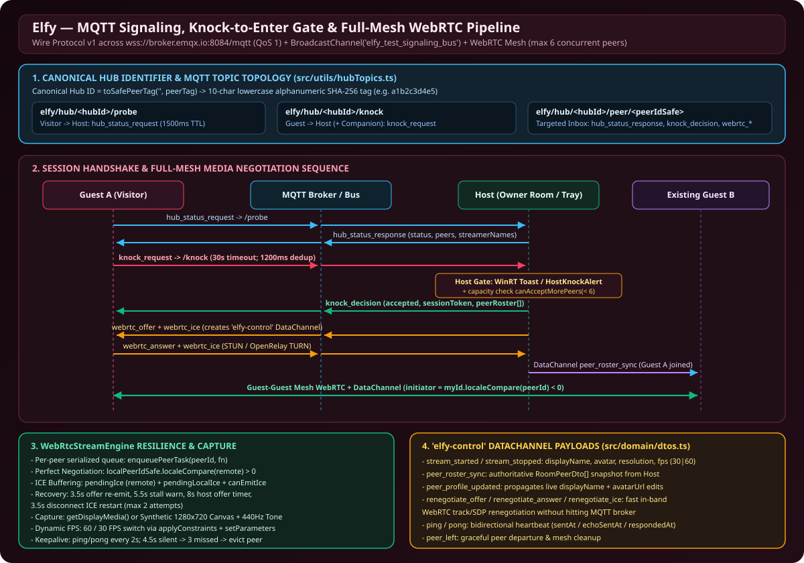
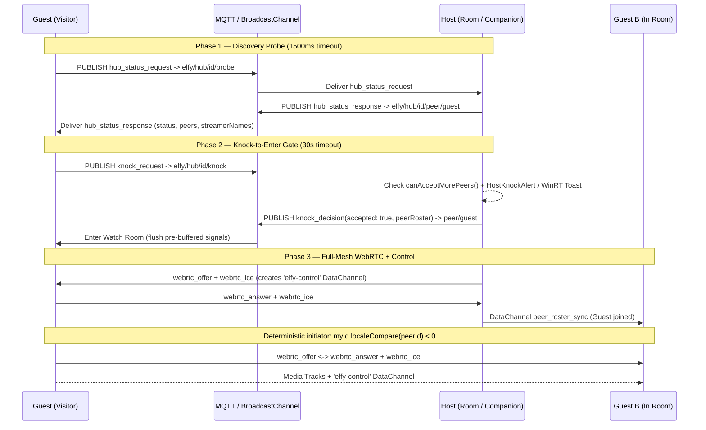
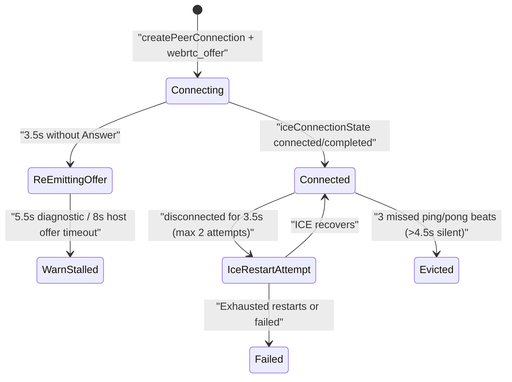

# 03 — Signaling & Full-Mesh WebRTC Engine

Elfy implements a decentralized **full-mesh WebRTC watch-room architecture** coordinated over lightweight **MQTT over WebSockets** (`wss://broker.emqx.io:8084/mqtt`, QoS 1) and an in-browser `BroadcastChannel` bridge (`elfy_test_signaling_bus`) for E2E/local tab testing.

---

## 1. Canonical Hub Addressing & MQTT Topic Topology (`src/utils/hubTopics.ts`)

Every user gets a deterministic, immutable 10-character hexadecimal `peer_tag` derived from SHA-256 of their machine UID. Display strings may include `#` or legacy `Nickname#tag` shapes, so `normalizeHubTopic()` strips noise down to the canonical `elfy/hub/<hubId>` prefix:

| Helper Function | Output Format | Purpose |
| --- | --- | --- |
| `toSafePeerTag(nickname, peerTag)` | `a1b2c3d4e5` | Lowercase alphanumeric canonical ID (`#` stripped; ignores mutable nickname) |
| `formatFullPeerTag(_nickname, peerTag)` | `#a1b2c3d4e5` | Formatted display tag pill |
| `normalizeHubTopic(rawHub)` | `elfy/hub/<hubId>` | Canonical base topic parsed from share strings/tags |
| `getProbeTopic(hubInput)` | `elfy/hub/<hubId>/probe` | Visitor -> Host live status discovery checks |
| `getKnockTopic(hubInput)` | `elfy/hub/<hubId>/knock` | Guest -> Host entrance requests (`knock_request`) |
| `getGuestInboxTopic(hubInput, guestTagSafe)` | `elfy/hub/<hubId>/peer/<guestTagSafe>` | Targeted signaling inbox for `hub_status_response`, `knock_decision`, `webrtc_*` |

> [!IMPORTANT]
> **Routing Note (`normalizeHubTopic`)**: Mutable nicknames are stripped out of topics so two friends always resolve the same room ID even after nickname edits. Side effect: `extractHostFromHub()` returns `displayName: 'Hub'` for `#id`-only codes until the first accepted knock populates `ownerNickname` in storage.

---

## 2. Wire Protocol Contracts (`src/domain/dtos.ts` & `src/domain/validators.ts`)

All messages carry `version: 1` and `sentAt` timestamps, and are strictly validated at runtime by `parseSignalingEnvelope()` and `parseDataChannelMessage()` before touching hook state.

### Signaling Envelopes (`SignalingEnvelopeDto`, 8 Payload Types)

Envelope wrapper: `{ version: 1, messageId, hubId, senderPeerIdSafe, sentAt, payload }`

| `payload.type` | Direction | Topic | Key Fields |
| --- | --- | --- | --- |
| `hub_status_request` | Visitor -> Host | `/probe` | `requesterIdSafe`, `replyTopic`, `requestId` |
| `hub_status_response` | Host -> Visitor | `/peer/<peer>` | `requestId`, `hubId`, `status` (`'broadcasting' \| 'online' \| 'offline'`), `peers`, `streamerNames[]`, `respondedAt` |
| `knock_request` | Guest -> Host (Room & Companion) | `/knock` | `peerTag`, `peerIdSafe`, `displayName`, `avatarUrl`, `replyTopic` |
| `knock_decision` | Host -> Guest | `/peer/<guest>` | `accepted`, `sessionToken`, `peerRoster[]`, `hostPeerIdSafe`, `hostDisplayName`, `reason?` |
| `webrtc_offer` | Initiator -> Target | `/peer/<target>` | `sessionToken`, `fromPeerIdSafe`, `replyTopic`, `sdp` (`RTCSessionDescriptionInit`) |
| `webrtc_answer` | Responder -> Initiator | `/peer/<initiator>` | `sessionToken`, `fromPeerIdSafe`, `sdp` (`RTCSessionDescriptionInit`) |
| `webrtc_ice` | Peer -> Peer | `/peer/<target>` | `sessionToken`, `fromPeerIdSafe`, `candidate` (`RTCIceCandidateInit`) |
| `peer_left` | Peer -> Room/Host | `/peer/<target>` | `peerIdSafe` |

### `elfy-control` DataChannel Envelopes (`DataChannelEnvelopeDto`, 10 Payload Types)

Envelope wrapper: `{ version: 1, sessionToken, senderPeerIdSafe, sentAt, payload }`

Once peer connections open a reliable `'elfy-control'` `RTCDataChannel`, room state and in-band renegotiation flow directly P2P without hitting the public MQTT broker:

| `payload.type` | Purpose | Key Fields |
| --- | --- | --- |
| `peer_roster_sync` | Host broadcasts authoritative room roster | `peers: RoomPeerDto[]` |
| `stream_started` | Peer started sharing screen/audio | `peerIdSafe`, `displayName`, `avatarUrl`, `resolution` (`720p \| 1080p \| source`), `fps` (`30 \| 60 \| 120`) |
| `stream_stopped` | Peer stopped sharing | `peerIdSafe` |
| `peer_profile_updated` | Propagates live nickname/avatar edits | `peerIdSafe`, `displayName`, `avatarUrl` |
| `renegotiate_offer` | Direct in-band SDP renegotiation offer | `fromPeerIdSafe`, `sdp` |
| `renegotiate_answer` | Direct in-band SDP renegotiation answer | `fromPeerIdSafe`, `sdp` |
| `renegotiate_ice` | Direct in-band trickle ICE candidate | `fromPeerIdSafe`, `candidate` |
| `peer_left` | Graceful departure & immediate mesh cleanup | `peerIdSafe` |
| `ping` | Keepalive request sent every 2s | `sentAt` |
| `pong` | Keepalive acknowledgment | `echoSentAt`, `respondedAt` |

---

## 3. End-to-End Session Workflows

### Knock-to-Enter Admission & Background Companion Routing
1. `useRoomSession` (guest) subscribes to `/peer/<guest>` first, then publishes `knock_request` onto `/knock` with a **30-second gate timer** (`KNOCK_TIMEOUT_MS = 30000`, `GuestKnockGate`).
2. **Dual Listeners on Owner Side**:
   - When the Watch Room (`stream`) is open (`useRoomSession`), incoming knocks appear in `HostKnockAlert` AND trigger `showKnockNotification` + `playKnockSound` (deduplicated over 1200ms in memory + `localStorage`).
   - Even when the Watch Room is closed, the hidden `main` Companion window (`useFriendHubsDiscovery`) stays subscribed to the owner's `/knock` topic, firing a native Windows interactive Toast (`Allow` / `Decline`).
   - Clicking `Allow` in the background toast opens `stream`, while `ToastState` in Rust (`src-tauri/src/toast.rs`) atomically routes or queues `KnockToastActionEvent` (`register_owner_room_session`, `unregister_owner_room_session`, `consume_pending_toast_actions`, `claim_toast_action`) so the host accepts the waiting guest immediately upon room open without duplicate prompting or `localStorage` polling races.
3. **Capacity Check**: `canAcceptMorePeers()` enforces `ROOM_CONFIG.MAX_CONCURRENT_PEERS` (`6`) when `ENFORCE_MAX_PEERS` is `true`, otherwise replying `knock_decision` (`accepted: false`, `reason` indicating room capacity).

---

## 4. `WebRtcStreamEngine` Resilience & Media Mechanics (`src/adapters/webrtcStreamEngine.ts` + `src/adapters/webrtc/`)

`WebRtcStreamEngine` (`213`-line facade over `captureManager.ts`, `codecSelector.ts`, `peerNegotiator.ts`, `dataChannelRouter.ts`, `statsCollector.ts`, and `peerTypes.ts`) manages per-peer `RTCPeerConnection` lifecycles across a mesh of up to 6 peers:

- **Automatic Hardware-First Codec Selection (`codecSelector.ts`)**: Before creating offers or answers, `applyPreferredVideoCodecs()` probes `navigator.mediaCapabilities.encodingInfo({ type: 'webrtc', ... })` for `powerEfficient` support and combines that with `RTCRtpSender.getCapabilities('video')` to rank hardware-capable profiles first via `transceiver.setCodecPreferences()` (preferring H.264 High `6400` / Main `4d00` / Baseline `4200` ahead of AV1/VP9 and demoting Constrained Baseline `42e0`, because Windows MediaFoundation/Edge routes `42e0` to CPU OpenH264 while engaging NVENC/QSV/AMF on `6400`/`4d00`/`4200`, retaining RTX/RED/ULPFEC payloads) — with **no manual codec picker exposed to the user**.

### Connection Negotiation & Glare Prevention
- **Serialized Task Queue**: Every SDP/ICE mutation for a peer runs sequentially through `enqueuePeerTask(peerId, fn)` so concurrent offers, answers, and track additions never race `signalingState`.
- **Perfect Negotiation (`isPolitePeer`)**: Deterministically assigns politeness via `localPeerIdSafe.localeCompare(remotePeerIdSafe) > 0` so simultaneous offer collisions resolve cleanly via rollback.
- **Guest-Guest Mesh Topology**: Guests do not rely on a central media server; when `peer_roster_sync` introduces two guests, whichever satisfies `myId.localeCompare(peerId) < 0` initiates the direct `RTCPeerConnection`.
- **Bi-Directional ICE Buffering**:
  - Incoming remote ICE candidates arriving before `setRemoteDescription` queue in `pendingIce`.
  - Outgoing local ICE candidates buffer in `pendingLocalIce` until `canEmitIce` flips true after signaling readiness.

### Timeout Recovery & Keepalive State Machine

### ICE Servers (`src/utils/stun.ts`)
Uses `getRtcConfiguration()` with `iceCandidatePoolSize: 4` and `bundlePolicy: 'max-bundle'`, configured with:
- 5 Google STUN endpoints (`stun.l.google.com:19302` and `stun1..stun4.l.google.com:19302`)
- 1 Cloudflare STUN endpoint (`stun.cloudflare.com:3478`)
- 4 OpenRelay Metered TURN/TURNS endpoints (`openrelay.metered.ca` on ports `80` and `443`, UDP & TCP) for symmetric NAT traversal.

### Screen Capture, Synthetic Stream Fallback, Resolution Presets & `30 / 60 / 120` FPS Control
- **Production Screen Share**: Calls `navigator.mediaDevices.getDisplayMedia()` capturing screen/window video + optional audio (with CPU audio DSP flags `echoCancellation`, `noiseSuppression`, and `autoGainControl` requested as `false`, safely retrying without those constraints on `OverconstrainedError`/`TypeError`), preserves native screenshare `contentHint` (`''` so Chromium keeps screenshare BWE rather than camera `kRealtimeVideo` frame-drop throttling), decorates remote `m=video` SDPs via `sdpBitrate.ts` (`b=AS`, `x-google-start-bitrate`, `x-google-min-bitrate`, `x-google-max-bitrate`) when sharing so hardware encoders ramp immediately instead of starving at 300 kbps, attaches senders with `degradationPreference: 'maintain-framerate'`, scales `maxBitrate` by preset and active viewer count (`MESH_BITRATE_SCALE_BY_VIEWERS`), applies adaptive soft CPU throttling (`0.72` factor when `qualityLimitationReason === 'cpu'`), and listens to track `'ended'` events so OS "Stop Sharing" controls sync `stream_stopped`.
- **Headless / E2E Synthetic Fallback**: When `__ELFY_FORCE_SYNTHETIC_STREAM__`, `__ELFY_TEST_STREAM__`, or `navigator.webdriver` is active (or `getDisplayMedia` is unavailable in headless environments), `CaptureManager` renders a live `<canvas>` animation (`ELFY STREAM · <FPS> FPS · FRAME N` at `720p` / `1080p` / `source` dimensions over a gradient with a moving rose circle) paired with a quiet 440Hz Web Audio oscillator track.
- **Dynamic FPS (`30 | 60 | 120`) & Resolution (`720p | 1080p | source`) Switching**: Updates capture track constraints (`applyConstraints()`), `RTCRtpSender.setParameters()`, or seamlessly swaps the synthetic canvas loop track, while `BottomDock` also lets hosts keep local self-preview **off by default** (`isLocalPreviewEnabled = false`, opt-in via `"Preview My Stream"` / `dock-self-preview-btn`) to eliminate local video decoding overhead while gaming.
- **Playwright Audio/Autoplay Workaround**: `StreamTile.tsx` wraps `<video>` inside `useAttachedVideoStream()`, falling back to muted playback if autoplay blocks audio and unlocking sound on pointer interaction or `autoplay-policy=no-user-gesture-required`.

### MQTT Adapter Safeguards (`src/adapters/mqttSignalingAdapter.ts`)
- **Offline Publishing Queue**: Buffers up to `MAX_PENDING_PUBLISHES = 100` outbound messages while connecting/reconnecting (`reconnectPeriod: 4000`, `connectTimeout: 6000`).
- **De-duplication Ring**: Stores up to `MAX_SEEN_IDS = 500` envelope IDs (`messageId`) so QoS 1 broker redeliveries and `BroadcastChannel` echoes never trigger duplicate knocks or WebRTC offers.
- **Warm Topic Subscriptions**: Calling `detachTopicHandler` removes the UI callback without unsubscribing the underlying MQTT channel immediately, preventing subscription race gaps across room transitions.
