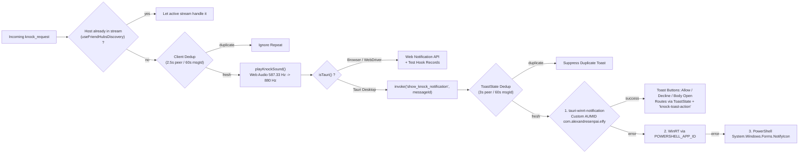

# 04 — Tauri Backend, Persistence, Notifications & Telemetry

The native desktop backend lives under `src-tauri/` and bridges OS windowing, single-instance enforcement, pooled SQLite persistence, hardware machine UID identity, Windows notifications & atomic toast action routing, and `sysinfo` performance telemetry to the React frontend via **25 registered Tauri IPC commands**.

---

## 1. Rust Module Structure (`src-tauri/src/`)

| File | Lines | Responsibility |
| --- | --- | --- |
| `src/main.rs` | 6 | Desktop binary entry point delegating to `elfy_lib::run()` |
| `src/lib.rs` | 453 | Single-instance temp lock (`elfy_single_instance.lock`), system tray setup (`Position::TrayCenter`), blur/close window guards, lazy `register` window lifecycle, 13 window/app IPC commands, 1 unit test |
| `src/toast.rs` | 747 | Thread-safe `ToastState` managed state (dedup + atomic action queue/claim), Windows HKCU AUMID & WinRT Toast / PowerShell `NotifyIcon` pipeline, 5 toast IPC commands, 4 unit tests |
| `src/db.rs` | 575 | Pooled `DbState(Mutex<Connection>)` initialized once at startup, bundled `rusqlite` SQLite database (`elfy.sqlite`), WAL mode + 5000ms busy timeout, SHA-256 `peer_tag` derivation, `user_profile` & `friend_hubs` tables, 6 `db_*` IPC commands, 4 unit tests |
| `src/system_monitor.rs` | 111 | Global `OnceLock<Mutex<MonitorState>>` wrapping `sysinfo::System`, primed on startup, throttled by `MINIMUM_CPU_UPDATE_INTERVAL`, high-load evaluation, 1 IPC command (`get_system_metrics`), 2 unit tests |

---

## 2. Complete Tauri IPC Command Catalog (25 Commands)

All commands are invoked cleanly through typed wrappers in `src/utils/tauri.ts` (`safeInvoke` / `invokeOrThrow`) which return safe fallback values when `isTauri()` is `false`.

### Window, Tray & Drag Commands (`src-tauri/src/lib.rs`)

| Command | Arguments | Behavior |
| --- | --- | --- |
| `show_register_window` | — | Unminimizes, centers, shows, focuses `register` at `/register`, or lazily builds the window on demand when absent |
| `close_register_window` | — | Destroys/closes `register` (`window.close()`) so no idle setup WebView remains resident in RAM |
| `open_stream_window` | `hub_id?: String, auto_start: bool, joined_as?: String` | Navigates `stream` window to `/stream?hubId=...&autoStart=...(&joinedAs=...)`, unminimizes, shows & focuses it (frontend also emits `'request-start-stream'`) |
| `restore_stream_window` | — | Unminimizes, shows, and focuses `stream` |
| `close_stream_window` | — | Hides `stream` window and restores/centers `main` at `Position::TrayCenter` if hidden |
| `hide_main_window` | — | Hides `main` tray popover |
| `minimize_window` | *(invoking window)* | OS-minimizes the invoking `WebviewWindow` |
| `toggle_maximize_window` | *(invoking window)* | Toggles maximized/unmaximized state on the invoking window |
| `start_dragging` | *(invoking window)* | Initiates native window drag; if `main`, arms `MAIN_WINDOW_DRAGGING` + `MAIN_DRAG_GUARD_UNTIL_MS` (1500ms / 500ms) so blur doesn't auto-hide mid-drag |
| `toggle_fullscreen` | *(invoking window)* | Toggles fullscreen state and returns new `bool` |
| `set_fullscreen` | `fullscreen: bool` | Sets explicit fullscreen state on the invoking window |
| `is_fullscreen` | *(invoking window)* | Returns current `bool` fullscreen state |
| `quit_app` | — | Cleanly terminates the Tauri application (`app.exit(0)`) |

### Notification & Atomic Toast Coordination Commands (`src-tauri/src/toast.rs`)

| Command | Arguments | Behavior |
| --- | --- | --- |
| `show_knock_notification` | `display_name, peer_tag, peer_id_safe?, hub_id?, reply_topic?, message_id?` | Atomically deduplicates via `ToastState` (60s per `message_id`, 3s per `(hub_id, peer)`), requests user attention, and dispatches WinRT Toast -> PowerShell fallback (or `tauri_plugin_notification` on non-Windows) |
| `register_owner_room_session` | `hub_id: String` | Marks `hub_id` as actively hosted inside `stream` so toast clicks route directly to `stream` |
| `unregister_owner_room_session` | `hub_id: String` | Clears the active owner room marker when `stream` closes or switches rooms |
| `consume_pending_toast_actions` | `hub_id: String` | Atomically drains queued background toast `accept` actions when host's `stream` room opens |
| `claim_toast_action` | `action_id: String` | Single-consumer claim guard (`bool`) preventing `main` and `stream` from processing the same toast interaction twice |

### Persistence Commands (`src-tauri/src/db.rs`)

| Command | Arguments | Behavior |
| --- | --- | --- |
| `db_get_or_init_profile` | `raw_machine_uid, default_nickname, default_tag, default_avatar` | Hashes `raw_machine_uid` with SHA-256 (`machine_hash`), derives fixed 10-hex `#peer_tag`, inserts default `user_profile` row if absent, returns `ProfileRowDto` |
| `db_update_profile` | `raw_machine_uid, nickname, avatar_url, preferred_fps?` | Updates profile metadata and `updated_at` timestamp, returns updated `ProfileRowDto` |
| `db_set_telemetry_consent` | `raw_machine_uid, consent` | Persists `'unset' \| 'granted' \| 'denied'` |
| `db_list_friend_hubs` | — | Queries all saved hubs ordered `is_favorite DESC, last_joined_at DESC, hub_id ASC` |
| `db_upsert_friend_hub` | `hub: FriendHubRowDto` | Inserts or updates a saved friend hub record and returns updated list |
| `db_remove_friend_hub` | `hub_id: String` | Deletes a friend hub by primary key and returns updated list |

### Hardware & Metrics Commands (`src-tauri/src/system_monitor.rs`)

| Command | Arguments | Returns |
| --- | --- | --- |
| `get_system_metrics` | — | `HostResourceMetricsDto`: `{ cpuUsagePercent, memoryUsedMb, memoryTotalMb, highLoadWarning }` (`highLoadWarning` when CPU >= 80.0% or RAM >= 85%) |

---

## 3. SQLite Database Schema (`src-tauri/src/db.rs`)

Stored in `<app_local_data_dir>/elfy.sqlite` and managed via a single startup-initialized **`DbState(Mutex<Connection>)`** (`init_db()` in `lib.rs` setup) with `PRAGMA journal_mode = WAL;` and `busy_timeout = 5000ms` (eliminating per-command connection opens and schema DDL calls).

```mermaid
erDiagram
    user_profile {
        TEXT machine_hash PK "SHA-256 hex of raw machine UID"
        TEXT peer_tag UNIQUE "Fixed 10-hex derived tag"
        TEXT nickname
        TEXT avatar_url
        TEXT telemetry_consent "unset | granted | denied"
        INTEGER preferred_fps "30, 60, or 120"
        INTEGER updated_at "Unix epoch ms"
    }

    friend_hubs {
        TEXT hub_id PK "Canonical normalized hub ID"
        TEXT owner_nickname
        TEXT owner_tag
        TEXT owner_avatar
        INTEGER last_joined_at "Unix epoch ms"
        INTEGER is_favorite "0 or 1"
    }
```

> [!NOTE]
> `useProfile()` derives `isRegistered = !isLoading && Boolean(profile.machineHash)` in TypeScript rather than storing a dedicated column in `user_profile`. Also note that `SqliteStorageRepository.listFriendHubs()` re-sorts the returned list using `sortHubsByRecent()`, overriding SQLite's `is_favorite DESC` ordering (see [06 — Testing & Improvement Roadmap](./06-testing-and-improvement-roadmap.md)).

---

## 4. Desktop Notification & Audio Chime Pipeline

When a guest knocks on an owner's Hub, `src/utils/notifications.ts` coordinates audio feedback and OS alerts:



- **Windows App Identity (AUMID)**: `init_windows_toast_aumid()` in `src-tauri/src/toast.rs` registers `HKCU\Software\Classes\AppUserModelId\com.alexandresenpai.elfy` with display name `"Elfy"` and writes a temp icon (`elfy_toast_icon.png`) so Windows Action Center renders interactive toasts with **`Allow`** (`accept`), **`Decline`** (`reject`), and toast body **`open`** actions without requiring MSIX packaging.
- **Atomic Toast Coordination Between Windows**: `ToastState` tracks `active_owner_hub`, `pending_actions` (20s TTL), and `claimed_actions` (60s TTL). If the owner's `stream` room is open, toast clicks route straight to `stream` with single-consumer `claim_toast_action(actionId)`; when no owner room is active, background `accept` actions are queued atomically in `ToastState` and drained once by `consume_pending_toast_actions(hubId)` as `useKnockGate` initializes — eliminating multi-window `localStorage` races and double-fired notifications.

---

## 5. System Monitoring & Privacy-Gated GA4 Telemetry

### Dual-Source Performance Monitoring (`src/adapters/systemMonitorAdapter.ts` & `src/hooks/useRoomMetrics.ts`)
Polled every **2 seconds** (`METRICS_POLL_MS = 2000`, decoupled from keepalive `KEEPALIVE_POLL_MS = 2000`) during active Watch Room sessions and displayed live inside `BottomDock` (`CPU X% · RAM YMB · Z FPS`, plus HW/SW codec badge):
- **Host Metrics**: Native `sysinfo` CPU/RAM in Tauri, or browser `setTimeout` drift estimation + `performance.memory` JS heap in Chromium.
- **Stream Health (`WebRtcStreamEngine.getStatsSnapshot()`)**: Collects `outboundFps`, `inboundFps`, `droppedFrames`, `rttMs`, `activeCodec`, `isHardwareAccelerated`, `encoderImplementation`, `qualityLimitationReason`, and `outboundBitrateKbps`.
- **Auto Warning & Soft CPU Throttle (`highLoadWarning`)**: Triggers if Rust warns (`CPU >= 80%` or `RAM >= 85%`), browser thresholds trip (`CPU >= 85%` or `RAM >= 90%`), WebRTC reports `qualityLimitationReason === 'cpu'` (also engaging a `0.72` bitrate soft throttle), active software CPU encoding is detected (`isHardwareAccelerated === false`), throttled/non-idle outbound FPS falls `< 22` (`LOW_FPS_WARNING_THRESHOLD` with quality limitation or SW fallback), or dropped frames exceed `> 45` (`HIGH_DROPPED_FRAMES_THRESHOLD`).

### Consent-Gated Telemetry (`src/adapters/telemetryAdapter.ts` & `src/domain/config.ts`)
- Strictly blocked unless `telemetryConsent === 'granted'`.
- Runs `sanitizeTelemetryParams()` allowing only non-PII categorical buckets (`role`, `fps`, `peerCountTier`, `cpuTier`, `ramTier`, `rttBucket`).
- Tracks 7 structured `TelemetryEventName` events (`app_opened`, `room_joined`, `stream_started`, `stream_stopped`, `fps_changed`, `high_load_detected`, `knock_accepted`) to GA4 Measurement Protocol (`https://www.google-analytics.com/mp/collect`, `keepalive: true`), and mirrors the latest `200` events (`MAX_RECORDED_EVENTS`) onto `window.__ELFY_TELEMETRY_EVENTS__` for Playwright assertions.

---

## 6. Security Model, CSP & Tauri Permissions

- **Content Security Policy (`src-tauri/tauri.conf.json`)**:
  - Restricts connections (`connect-src`) strictly to `self`, `ipc:`, `http://ipc.localhost`, `wss://broker.emqx.io:8084`, `https://www.google-analytics.com`, and local dev WebSocket/HTTP endpoints.
  - Allows `media-src 'self' blob: mediastream:` for WebRTC streams and Google Fonts (`fonts.googleapis.com`, `fonts.gstatic.com`) for typography/Material Icons.
- **Single-Instance Lock (`src-tauri/src/lib.rs`)**: Holds an exclusive lock handle on `<temp_dir>/elfy_single_instance.lock` on startup to prevent two desktop instances colliding over tray icons or SQLite handles (verified by `single_instance_lock_prevents_concurrent_holders`).
- **Tauri Capabilities (`src-tauri/capabilities/default.json`)**: Grants `windows: ["*"]` least-required ACL scopes for `core:default`, `opener:default`, `notification:*`, `machine-uid:*`, and frameless window controls (`startDragging`, hide, show, minimize, maximize, focus, center, close, setFullscreen).
